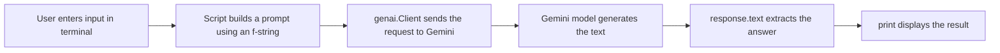

<p align="center">
  <a href="https://www.python.org/"></a>
  <a href="https://ai.google.dev/"></a>
  <a href="https://googleapis.github.io/python-genai/"></a>
  <a href="https://pypi.org/project/python-dotenv/"></a>
  <a href="https://aistudio.google.com/"></a>
  <a href="https://code.visualstudio.com/"></a>
  <a href="https://pip.pypa.io/"></a>
  <a href="https://git-scm.com/"></a>
  <a href="https://github.com/"></a>
</p>

<h1 align="center">GENAI: Real-Life Generative AI Projects with Google Gemini</h1>

<p align="center">
  A collection of five practical Python applications that use the Google Gemini API to solve everyday business and academic tasks, from customer support replies to meeting summaries and study notes.
</p>

---

## Table of Contents

- [Overview](#overview)
- [Projects at a Glance](#projects-at-a-glance)
- [How It Works](#how-it-works)
- [Tech Stack](#tech-stack)
- [Project Structure](#project-structure)
- [Prerequisites](#prerequisites)
- [Installation and Setup](#installation-and-setup)
- [Usage](#usage)
- [Code Explanation](#code-explanation)
- [Troubleshooting](#troubleshooting)
- [Security Notes](#security-notes)
- [Roadmap](#roadmap)
- [License](#license)
- [Acknowledgments](#acknowledgments)

---

## Overview

This repository contains five independent Python scripts (`lab1.py` to `lab5.py`). Each script follows the same pattern: it takes input from the user, wraps that input inside a carefully written instruction (a *prompt*), sends the prompt to a Gemini model, and prints the generated text.

The projects are designed to show how generative AI can be applied to real situations rather than abstract examples. Every lab has a clear purpose, a defined output format, and explicit rules that guide the AI's response.

## Projects at a Glance

| Lab | File | Real-Life Use Case | Input | Output |
|-----|------|--------------------|-------|--------|
| 1 | `lab1.py` | AI Customer Support Reply Generator | Customer complaint | Polite reply under 100 words |
| 2 | `lab2.py` | AI Resume Improvement Assistant | Student skills | Professional 4 to 5 sentence resume summary |
| 3 | `lab3.py` | AI Meeting Summary Generator | Meeting transcript | Summary, decisions, action items, and owners |
| 4 | `lab4.py` | AI Product Description Generator | Product name and features | E-commerce description under 150 words |
| 5 | `lab5.py` | AI Study Assistant | Any topic | Definition, explanation, example, key points, and interview questions |

---

## How It Works

Every program in this repository follows the same flow:



The key idea is that the quality of the output depends heavily on the quality of the prompt. Each lab therefore defines a role for the AI, supplies the user's data, and lists specific requirements such as length, tone, and structure.

---

## Tech Stack

Each technology below links to its official website or documentation.

| Technology | Purpose in This Project | Official Link |
|------------|-------------------------|---------------|
| Python | Core programming language for all scripts | [python.org](https://www.python.org/) |
| Google Gemini API | Large language model that generates the text | [ai.google.dev](https://ai.google.dev/) |
| Google GenAI SDK (`google-genai`) | Python library used to call the Gemini API | [googleapis.github.io/python-genai](https://googleapis.github.io/python-genai/) |
| python-dotenv | Loads the API key from a `.env` file | [pypi.org/project/python-dotenv](https://pypi.org/project/python-dotenv/) |
| Google AI Studio | Creates and manages the Gemini API key | [aistudio.google.com](https://aistudio.google.com/) |
| VS Code | Recommended code editor | [code.visualstudio.com](https://code.visualstudio.com/) |
| pip | Installs Python packages from `requirements.txt` | [pip.pypa.io](https://pip.pypa.io/) |
| Git and GitHub | Version control and project hosting | [git-scm.com](https://git-scm.com/) and [github.com](https://github.com/) |

---

## Project Structure

```
GENAI/
├── lab1.py            # AI Customer Support Reply Generator
├── lab2.py            # AI Resume Improvement Assistant
├── lab3.py            # AI Meeting Summary Generator
├── lab4.py            # AI Product Description Generator
├── lab5.py            # AI Study Assistant
├── requirements.txt   # Python dependencies
├── .env               # Local secret file (not committed to GitHub)
├── .gitignore         # Files Git should ignore
└── README.md          # Project documentation
```

---

## Prerequisites

- Python 3.9 or newer (the project was developed and tested with Python 3.13)
- A Google account to create a Gemini API key
- An internet connection
- Optional: VS Code, Anaconda, or any terminal of your choice

---

## Installation and Setup

### Step 1: Get the Code

```bash
git clone https://github.com/<your-username>/GENAI.git
cd GENAI
```

### Step 2: Create a Virtual Environment

A virtual environment keeps this project's packages separate from the rest of your system.

**Option A: Conda (used during development)**

```bash
conda create -n batch3_ai python=3.13 -y
conda activate batch3_ai
```

**Option B: Built-in venv on Windows (PowerShell)**

```powershell
python -m venv venv
.\venv\Scripts\Activate.ps1
```

**Option B: Built-in venv on macOS or Linux**

```bash
python3 -m venv venv
source venv/bin/activate
```

### Step 3: Install the Dependencies

```bash
pip install -r requirements.txt
```

This installs the two packages listed in `requirements.txt`:

- `google-genai` for calling the Gemini API
- `python-dotenv` for reading the `.env` file

### Step 4: Create a Gemini API Key

1. Open [Google AI Studio](https://aistudio.google.com/).
2. Sign in with your Google account.
3. Select **Get API key** and create a new key.
4. Copy the key. You will need it in the next step.

### Step 5: Create the `.env` File

Create a file named `.env` in the root of the project folder and add your key:

```env
GEMINI_API_KEY=your_api_key_here
```

Do not add quotation marks or spaces around the `=` sign.

---

## Usage

Run any lab from the project folder:

```bash
python lab1.py
python lab2.py
python lab3.py
python lab4.py
python lab5.py
```

### Example: Lab 1 (Customer Support)

```text
Enter customer complaint: my ordered product was damaged

AI Generated Response:
Dear Customer,

I am so sorry to hear that your order arrived damaged! ...
```

### Example: Lab 2 (Resume Summary)

```text
Enter your skills: python,java,sql

Generated Resume Summary:
Recent computer science graduate with a solid academic foundation in core programming concepts and database management. ...
```

### Example: Lab 3 (Meeting Summary)

Lab 3 uses a sample transcript stored inside the script, so it runs without any input:

```text
AI Meeting Summary
------------------
1. Meeting Summary
2. Important Decisions
3. Action Items
4. Person Responsible
```

### Example: Lab 4 (Product Description)

```text
Enter product name: TV
Enter product features: hd

AI Generated Product Description:
Upgrade your home entertainment with our reliable HD television. ...
```

### Example: Lab 5 (Study Assistant)

```text
Enter a topic: python

AI Study Assistant
==================
1. Simple Definition
2. Easy Explanation
3. Real-Life Example
4. Important Points
5. Three Interview Questions with Answers
```

---

## Code Explanation

This section explains every important element of the code, step by step. Start with the shared pattern, because all five labs use it.

### Shared Pattern Used in Every Lab

#### Step 1: Import the Required Modules

```python
import os
from dotenv import load_dotenv
from google import genai
```

| Import | What It Does | Why It Is Used |
|--------|--------------|----------------|
| `os` | Gives access to the operating system, including environment variables | To read the API key with `os.getenv()` |
| `load_dotenv` | Reads the `.env` file and loads its values as environment variables | To keep the secret key out of the source code |
| `genai` | The Google GenAI SDK | To create a client and call Gemini models |

#### Step 2: Load the Environment Variables

```python
load_dotenv()
```

This reads the `.env` file in the project folder and makes `GEMINI_API_KEY` available to the program. It must run before the key is read.

#### Step 3: Create the Gemini Client

```python
client = genai.Client(api_key=os.getenv("GEMINI_API_KEY"))
```

- `os.getenv("GEMINI_API_KEY")` reads the key from the environment.
- `genai.Client(...)` creates a client object. The client stores the authentication details and handles the communication with Google's servers.

The client is created once at the top of each file and reused by every function. Creating it once is more efficient than creating a new connection for each request.

#### Step 4: Define a Function that Builds a Prompt

Each lab defines a function that accepts user data and returns the AI's response. The prompt is written as a multi-line f-string:

```python
prompt = f"""
You are a professional customer support executive.

Customer complaint:
{complaint}

Write a polite and professional response.
...
"""
```

- `f"""..."""` is a **triple-quoted f-string**. The triple quotes allow the prompt to span several lines, and the `f` prefix allows variables such as `{complaint}` to be inserted directly into the text.
- Each prompt has three parts: a **role** ("You are a professional customer support executive"), the **input data**, and the **requirements** (a bulleted list of rules).

Clear requirements are important because a language model has no fixed format by default. Rules such as "less than 100 words" or "4 to 5 sentences" make the output predictable and usable.

#### Step 5: Send the Request to Gemini

```python
response = client.models.generate_content(
    model="gemini-3.5-flash-lite",
    contents=prompt
)
```

| Argument | Meaning |
|----------|---------|
| `client.models` | The section of the SDK that works with models |
| `.generate_content()` | The method that sends the prompt and waits for the model's answer |
| `model=` | The name of the Gemini model to use. You can change this to any model available to your API key |
| `contents=` | The text sent to the model, which is the prompt built in Step 4 |

The `response` object contains the full result, including metadata such as token usage.

#### Step 6: Extract and Return the Text

```python
return response.text
```

`response.text` is the generated answer as a plain string. The function returns it so the caller can decide how to display it.

#### Step 7: Get Input and Print the Result

```python
complaint = input("Enter customer complaint: ")
reply = generate_reply(complaint)
print(reply)
```

- `input()` pauses the program, displays a message, and waits for the user to type something and press Enter. The typed text is returned as a string.
- `print()` displays text in the terminal.

Each script runs from top to bottom: it creates the client, defines the function, collects input, calls the function, and prints the output.

---

## Output

The screenshots below show the actual terminal output from each lab run.

### LAB 1: Customer Support Reply Generator


The first lines of this capture show an earlier run that returned a `404 NOT_FOUND` error for an unsupported model name. The second run, after correcting the configuration, generated a complete reply.

### LAB 2: Resume Improvement Assistant


Input: `python,java,sql`. The model produced a five-sentence fresher summary that mentions the three skills and a willingness to learn.

### LAB 3: Meeting Summary Generator


The model returned the four requested sections: a meeting summary, important decisions, action items, and the person responsible for each task.

### LAB 4: Product Description Generator


Input: product name `TV` and features `hd`. The model expanded the minimal input into a multi-paragraph description while keeping within the word limit.

### LAB 5: Study Assistant


Input: topic `python`. The output follows the five-part structure, using everyday analogies such as a smart coffee machine to explain the topic.


---

### Lab 1: AI Customer Support Reply Generator (`lab1.py`)

**Goal:** Turn a short, possibly frustrated customer complaint into a polite, professional reply.

**Function:** `generate_reply(complaint)`

| Step | Code | Explanation |
|------|------|-------------|
| 1 | `def generate_reply(complaint):` | Defines a function that accepts the complaint text as its only parameter. |
| 2 | `prompt = f"""..."""` | Assigns the role, the complaint, and the rules to a single prompt string. |
| 3 | Rules: apologize, acknowledge, offer a solution, be friendly, under 100 words | Each rule shapes the reply. The word limit keeps replies short enough for email or chat. |
| 4 | `client.models.generate_content(...)` | Sends the prompt to Gemini. |
| 5 | `return response.text` | Returns the generated reply. |
| 6 | `complaint = input(...)` | Collects the customer complaint from the user. |

**Why this design:** Customer support replies must be consistent in tone. Putting the tone rules in the prompt means every reply follows the same professional standard without manual editing.

---

### Lab 2: AI Resume Improvement Assistant (`lab2.py`)

**Goal:** Create a professional resume summary for a fresher based on a list of skills.

**Function:** `generate_resume_summary(skills)`

| Step | Code | Explanation |
|------|------|-------------|
| 1 | `def generate_resume_summary(skills):` | Accepts the user's skills as a string, for example `python,java,sql`. |
| 2 | `Student skills: {skills}` | Inserts the skills into the prompt. |
| 3 | `4 to 5 sentences` | Controls the length of the summary. |
| 4 | `Do not exaggerate skills` | Prevents the model from inventing experience the candidate does not have. |
| 5 | `Mention willingness to learn` | Adds a suitable tone for a candidate with limited work experience. |
| 6 | `Suitable for an IT job` | Gives the model the target industry for the vocabulary it should use. |

**Why this design:** Resumes must be honest. The "do not exaggerate" rule is an important guardrail, because language models can sometimes make achievements sound stronger than the input supports. Always review AI-generated resume content before using it.

---

### Lab 3: AI Meeting Summary Generator (`lab3.py`)

**Goal:** Read a meeting transcript and extract the summary, decisions, action items, and responsible people.

**Function:** `summarize_meeting(meeting_text)`

| Step | Code | Explanation |
|------|------|-------------|
| 1 | `meeting = """..."""` | Stores a sample transcript as a multi-line string. This version does not use `input()`. |
| 2 | `Analyze the following meeting transcript: {meeting_text}` | Inserts the transcript into the prompt. |
| 3 | Numbered list (1 to 4) | Forces the output into four fixed sections. |
| 4 | `Use simple and professional language` | Keeps the summary easy to read for busy managers. |
| 5 | `result = summarize_meeting(meeting)` | Calls the function with the transcript and stores the result. |

**Why this design:** A numbered list in the prompt produces a structured output that is easy to scan. To summarize your own meetings, replace the sample string with text typed by the user, or read it from a `.txt` file.

---

### Lab 4: AI Product Description Generator (`lab4.py`)

**Goal:** Write an e-commerce product description from a product name and a list of features.

**Function:** `generate_product_description(product_name, features)`

| Step | Code | Explanation |
|------|------|-------------|
| 1 | `def generate_product_description(product_name, features):` | Accepts two parameters, which makes the function more flexible than a single input. |
| 2 | `input("Enter product name: ")` and `input("Enter product features: ")` | Collects both values separately. |
| 3 | `Start with a short introduction` | Sets the structure of the description. |
| 4 | `Do not invent specifications` | Reduces the risk of false technical claims. |
| 5 | `Maximum 150 words` | Keeps the text suitable for product pages. |

**Why this design:** Product descriptions must be attractive but truthful. The rule "do not invent specifications" tells the model to use only the features provided.

**Limitation to be aware of:** Even with this rule, a language model may add marketing claims that were not in the input, such as lifestyle phrases or value statements. Always review generated product text before publishing it.

---

### Lab 5: AI Study Assistant (`lab5.py`)

**Goal:** Explain any college-level topic in beginner-friendly language with a fixed learning structure.

**Function:** `study_assistant(topic)`

| Step | Code | Explanation |
|------|------|-------------|
| 1 | `def study_assistant(topic):` | Accepts a topic name such as `python` or `machine learning`. |
| 2 | `You are an AI study assistant for college students.` | Sets the audience and the role. |
| 3 | Numbered structure (1 to 5) | Guarantees the same learning flow for every topic: definition, explanation, example, key points, and interview questions. |
| 4 | `Use beginner-friendly language` | Avoids unnecessary jargon. |
| 5 | `Avoid unnecessary technical complexity` | Keeps explanations focused on understanding rather than detail. |

**Why this design:** A consistent structure helps students learn in a repeatable way. The interview questions add practical value by connecting the topic to career preparation.

**Note on formatting:** The model may return Markdown symbols such as `**bold**` and `###` headings. These display correctly in Markdown viewers such as GitHub or VS Code preview, but may look raw in the terminal.

---


## Troubleshooting

| Problem | Likely Cause | Solution |
|---------|--------------|----------|
| `GEMINI_API_KEY` is `None` or authentication fails | The `.env` file is missing, misnamed, or in the wrong folder | Make sure the file is named exactly `.env` and is in the project root. Check that the line reads `GEMINI_API_KEY=your_key` with no quotes. |
| `404 NOT_FOUND ... model ... is not found` | The model name is not available for your API key or API version | Check the current model list in the [Gemini models documentation](https://ai.google.dev/gemini-api/docs/models) and update the `model=` argument in the script. |
| `ModuleNotFoundError: No module named 'google'` | Dependencies are not installed in the active environment | Activate your environment and run `pip install -r requirements.txt`. |
| `ModuleNotFoundError: No module named 'dotenv'` | `python-dotenv` is not installed | Run `pip install python-dotenv`, or reinstall from `requirements.txt`. |
| PowerShell says scripts are disabled | Windows execution policy blocks activation scripts | Run `Set-ExecutionPolicy -Scope CurrentUser RemoteSigned` once, then activate the environment again. |
| Output is in the wrong language or format | The prompt rules are too loose | Make the requirements in the prompt more specific. |

---

## Security Notes

- **Never commit your API key.** Add `.env` to `.gitignore` before pushing to GitHub.
- **Revoke any exposed key immediately.** You can delete or regenerate keys in [Google AI Studio](https://aistudio.google.com/).
- **Review AI output before use.** Generated replies, summaries, and descriptions can contain errors or invented details.

Recommended `.gitignore` content:

```gitignore
.env
venv/
__pycache__/
```

---

## Roadmap

- Add `try` and `except` error handling around API calls
- Move all prompts into a separate module for easier editing
- Read meeting transcripts from `.txt` files
- Build a web interface with Streamlit or Flask
- Add a menu that lets the user choose any of the five labs
- Add automated tests for the prompt-building functions
- Add a `temperature` setting to control how creative the output is

---

## License

This project is licensed under the MIT License. See the `LICENSE` file for details.

---

## Acknowledgments

- [Google Gemini API](https://ai.google.dev/) for the language model
- [Google GenAI Python SDK](https://googleapis.github.io/python-genai/) for the client library
- [python-dotenv](https://pypi.org/project/python-dotenv/) for environment variable management
- [Shields.io](https://shields.io/) for the README badges
